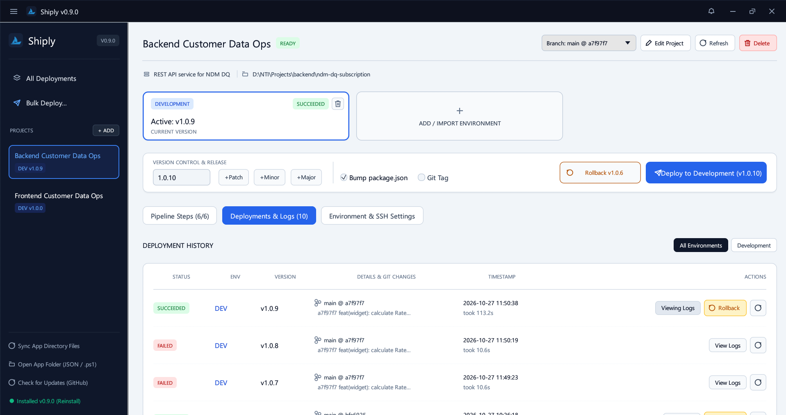
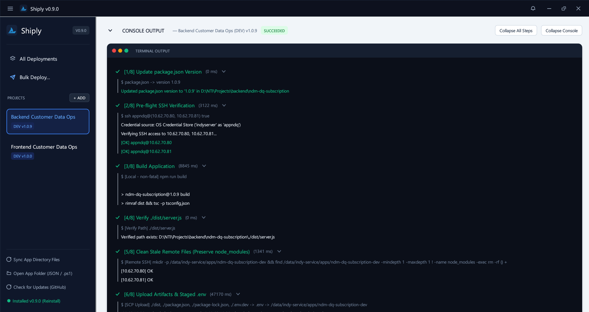

# Shiply

Desktop deployment tool for on-prem/VPN environments.

Shiply is a fast, lightweight, cross-platform desktop application built in pure **Rust** (`eframe` / `egui`). It gives developers a structured, visual interface to configure multi-environment deployment pipelines, run local builds, upload build artifacts via SCP, execute remote SSH commands, inspect Git commit changelogs, and perform one-click rollbacks — directly from their own workstation.

---

## Why Shiply?

Deploying applications to on-premise servers that require VPN access is a frequent operational headache:

- **Ad-hoc deploy scripts get messy**: Plain shell or PowerShell (`.ps1`) deployment scripts rarely include version tracking, automated rollbacks, or execution history logs. They are difficult for teammates to safely reuse, understand, or configure.
- **Full CI/CD is often out of reach**: Hosted CI/CD platforms (such as GitHub Actions or GitLab CI) cannot reach internal, private servers behind enterprise VPNs without complex self-hosted runner infrastructure, security exceptions, or bastion hosts. Setting up and maintaining full-blown CI/CD for internal tools or small services is often too heavy.
- **Developer machines already have VPN access**: Developers already have their VPN connected, SSH keys or credentials loaded, and local development environments configured.

**Shiply bridges this gap**: It runs on the developer's own workstation, leveraging existing network access to provide a repeatable, recorded, and reversible deployment process without requiring external build servers.

---

## Quick Start

```text
[Install Shiply] ──> [Import deploy.ps1 or Create Project] ──> [Click "Deploy to dev"]
```

1. **Install**: Download the latest release for your OS from [GitHub Releases](https://github.com/faidfadjri/shiply/releases) or build from source using Cargo.
2. **Import Script or Create Project**:
   - Click **Auto-Import deploy.ps1 Script** and select an existing deployment script (such as `deploy-dev.ps1`). Shiply automatically discovers target servers, SSH users, remote paths, and pipeline steps.
   - Or click **Create Project Manually** to configure your project from scratch.
3. **Deploy to Dev**: Select your target Git branch, choose or bump your release version, and click **Deploy**. Follow the real-time execution logs for every step.

---

## Screenshots


*Project workspace with multi-environment status cards, Git branch switcher, version bump controls, and one-click deployment.*


*Live terminal output with collapsible pipeline steps, execution timing stats, automated credential redaction, and rollback history.*

---

## Key Features

- **Universal Pipeline Builder**: Configure step-by-step deployment pipelines for any tech stack (Node.js, TypeScript, Rust, Go, Python, static frontends, PM2, systemd, Docker):
  - **Local Command**: Run build, test, or packaging commands locally (`npm run build`, `cargo build --release`, `pytest`) with optional non-fatal exit tolerance.
  - **Verify Local Path**: Verify that expected build artifacts exist (e.g. `./dist`, `./dist/server.js`) before initiating any remote actions.
  - **SCP File Transfer**: Upload build outputs, wildcards (`./dist/*`), and stage environment-specific files (`.env.dev` $\rightarrow$ `.env`) to remote servers.
  - **Remote SSH Command**: Execute remote commands across all target servers (`npm ci`, `pm2 restart`, `systemctl restart`, cleanup).
- **PowerShell Script (`.ps1`) Auto-Importer**: Point Shiply at an existing `deploy-*.ps1` script to extract target servers, usernames, remote paths, proxy settings, and execution steps automatically.
- **Custom Environments**: Create, clone, reorder, or delete environments (`dev`, `staging`, `production`, `uat`, `qa`, etc.) with independent server lists and pipeline steps.
- **Git Branch Selector & Commit Changelog**:
  - Switch branches directly from the project header before deploying.
  - Automatically records the active Git branch, short commit hash, and commit diff summary (`git diff --stat`) on each deployment record.
- **One-Click Rollback**:
  - Every deployment stores an immutable record of its target version, commit hash, and executed pipeline steps.
  - Roll back any environment to a previously successful deployment with a single click.
- **Zero-Prompt SSH Authentication**:
  - Authenticate using standard SSH keys or native OS credential vaults (Windows Credential Manager via `CredReadW`, macOS Keychain, Linux `libsecret`).
  - Native `SSH_ASKPASS` helper ensures passwords are never prompted interactively in the terminal per server.
- **Automated Parameter Validation & Secret Redaction**:
  - Template variables and target hosts are strictly validated to prevent command and flag injection.
  - Passwords and credentials are automatically redacted (`[REDACTED]`) from execution logs, summaries, and persistent state.

---

## Limitations & Trade-offs

Shiply is intentionally designed as a local desktop tool. Please consider the following trade-offs:

1. **Local State (No Central Audit Trail)**:
   - State and deployment history are stored locally in `shiply_state.json` on each developer's computer.
   - There is no central server, team database, or unified web dashboard. Other team members cannot see your local deployment history unless files are shared manually.
2. **Dependent on the Developer's Machine**:
   - Deployments run from the developer's workstation. If the machine disconnects from the VPN, sleeps, or loses network access during transfer, the deployment will fail or pause.
3. **Not a Full CI/CD or Orchestration Platform**:
   - Shiply does **not** replace automated CI/CD pipelines (GitHub Actions, GitLab CI), configuration management tools (Ansible, Puppet, Chef), or container orchestration systems (Kamal, Kubernetes).

### When to Use vs. When NOT to Use

| Scenario | Recommendation | Why |
| :--- | :--- | :--- |
| **On-prem / intranet servers behind VPN** | **Use Shiply** | Hosted CI/CD cannot reach private servers without dedicated runner setups; dev machines already have VPN access. |
| **Replacing messy deploy scripts** | **Use Shiply** | Adds visual progress, rollback, version bumping, and commit diff tracking to ad-hoc scripts. |
| **Cloud-native infra (AWS, GCP, Azure)** | **Do NOT use** | Use cloud-native CI/CD (GitHub Actions, GitLab CI) with direct cloud provider access. |
| **Large teams requiring central compliance logs** | **Do NOT use** | Use central CI/CD with mandatory approval gates and centralized immutable audit trails. |
| **Complex server provisioning / clustering** | **Do NOT use** | Use Ansible, Terraform, or Kubernetes for fleet orchestration and configuration management. |

---

## AI Disclosure

Shiply was designed and implemented with significant AI assistance. While the codebase includes automated unit and integration tests, you should review all code and test deployment pipelines on non-production (development or staging) environments before deploying to production infrastructure.

---

## Installation

Prebuilt binaries and installer packages are provided for Windows, Linux, and macOS on the [GitHub Releases](https://github.com/faidfadjri/shiply/releases) page. You can verify downloaded assets using `SHA256SUMS.txt`.

### Windows

- **Standalone Installer**: Download `setup.exe` (or `shiply-windows-x86_64.exe`) from GitHub Releases and run it. The installer installs Shiply to `%LOCALAPPDATA%\Programs\Shiply\shiply.exe` and creates Desktop and Start Menu shortcuts.
- **Scripted / PowerShell Install**:
  ```powershell
  # From a cloned repository or downloaded release folder:
  powershell -NoProfile -ExecutionPolicy Bypass -File .\Windows\install-windows.ps1
  ```
  If Cargo is installed, this will build from source; otherwise, it downloads the latest release binary.

### Linux

- **Shell Installer**:
  ```bash
  bash ./Linux/install-linux.sh
  ```
  Installs the executable to `~/.local/bin/shiply` and creates `~/.local/share/applications/shiply.desktop`.

### macOS

- **Installer Script & App Bundle**:
  Double-click `./Mac/install-mac.command` in Finder, or run:
  ```bash
  bash ./Mac/install-mac.sh
  ```
  Installs to `/Applications/Shiply.app` (or `~/Applications/Shiply.app`) and symlinks the CLI to `/usr/local/bin/shiply`.

### Building from Source

Requirements: [Rust](https://rustup.rs/) (1.75+ recommended).

```bash
git clone https://github.com/faidfadjri/shiply.git
cd shiply
cargo build --release
```
The compiled binary will be located at `./target/release/shiply` (or `shiply.exe` on Windows).

---

## Security & State Privacy

- **Credential Storage**: Credentials are never written in plain text to `shiply_state.json`. Shiply uses your operating system's native secure credential manager (Windows Credential Manager, macOS Keychain, Linux Secret Service).
- **Log Redaction**: Active passwords and secrets are systematically redacted (`[REDACTED]`) before command logs are displayed in the UI or written to history.
- **State File (`shiply_state.json`)**:
  - `shiply_state.json` stores your project configs, server hostnames, IP addresses, remote user names, and deployment step history.
  - **Safe for local private backups**: You can back up or migrate `shiply_state.json` between your own machines.
  - **NOT safe for public sharing**: Do **not** commit `shiply_state.json` to public repositories or share it with untrusted parties, as it contains internal network topology and infrastructure metadata.

---

## Template Variables Reference

The following placeholders can be used in **Local Commands**, **Verify Paths**, **SCP Sources**, or **Remote SSH** steps:

| Variable | Description | Example |
| :--- | :--- | :--- |
| `{app_name}` | Application or service name | `payment-service-dev` |
| `{remote_dir}` | Remote deployment directory on target servers | `/var/www/payment-service` |
| `{remote_user}` | SSH username for target servers | `deploy` |
| `{http_proxy}` | Outbound HTTP/HTTPS proxy URL | `http://10.0.0.1:8080` |
| `{env_source}` | Local environment file staged as `.env` | `./.env.dev` |
| `{version}` | Release version being deployed | `1.2.0` |

---

## Development & Testing

Run the linter and test suite:

```bash
cargo clippy --all-targets -- -D warnings
cargo test
```

## License

MIT License. See [LICENSE](LICENSE) for details.
